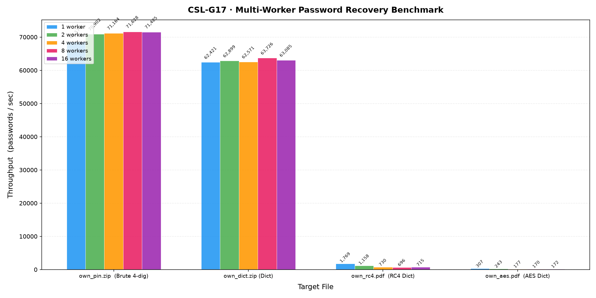

# CSL-G17 · Multithreaded Dictionary & Brute-Force Password Recovery Tool

> **RTU 7CS4-22 Experiment 3** — B.Tech VII Semester Cyber Security Lab  
> **Project Code:** CSL-G17  
> **Aligned with:** [RTU 7CS4-22 Syllabus (Experiment 3 – Dictionary & Brute-Force Attack)](https://rtu.ac.in/index/Adminpanel/Images/Media/Computer%20Science%20Engg.VII%20&%20VIII%20Sem..pdf)

---

## 📋 Overview

A complete, self-contained Python 3 tool that demonstrates **dictionary** and **brute-force** password recovery attacks on **self-created** protected ZIP and PDF files inside an isolated `./test_targets/` sandbox directory.

### Key Features

| Feature | Detail |
|---|---|
| **ZipCrypto ZIP cracking** | Pure-Python `_ZipCryptoCipher` creates encrypted ZIPs (no external `zip` binary) |
| **PDF cracking** | Supports RC4-128 and AES-256 encrypted PDFs via `pypdf` |
| **Dictionary + Rule Mutations** | lowercase, UPPER, Title, l33tspeak (`a→@, e→3, i→1, o→0, s→$`), + 6 suffixes |
| **Exhaustive Brute-Force** | `itertools.product` over configurable charsets and length bounds |
| **Multithreaded** | `concurrent.futures.ThreadPoolExecutor` with configurable worker count |
| **Early Termination** | `threading.Event` stops all threads the instant one finds the password |
| **Zero Disk I/O** | `io.BytesIO` in-memory buffering — no file contention across threads |
| **Benchmark Suite** | Throughput & speedup across 1–16 workers with matplotlib chart |

---

## ⚙️ Installation

### Prerequisites

- **Python 3.9+** (tested on 3.10–3.14)

### Install Dependencies

```bash
pip install pypdf pycryptodome matplotlib
```

> `pypdf` handles PDF encryption/decryption.  
> `pycryptodome` provides AES-256 support for `pypdf`.  
> `matplotlib` generates the benchmark chart.

---

## 🚀 Quick Start

### Step 1 — Generate Self-Owned Test Targets

```bash
python generate_test_files.py
```

This creates the `test_targets/` directory with:

| File | Type | Password | Purpose |
|---|---|---|---|
| `own_dict.zip` | ZipCrypto ZIP | `Jaipur2026` | Dictionary attack testing |
| `own_pin.zip` | ZipCrypto ZIP | `7492` | 4-digit brute-force testing |
| `own_rc4.pdf` | RC4-128 PDF | `skit@123` | PDF dictionary attack testing |
| `own_aes.pdf` | AES-256 PDF | `net99` | PDF dictionary attack testing |
| `wordlist.txt` | Text | — | 460+ base words for dictionary attacks |

### Step 2 — Run Dictionary Recovery

```bash
# Recover ZIP password with 4 workers
python zip_pdf_recovery.py \
    --file test_targets/own_dict.zip \
    --mode dict \
    --wordlist test_targets/wordlist.txt \
    --workers 4

# Recover PDF (RC4-128) password
python zip_pdf_recovery.py \
    --file test_targets/own_rc4.pdf \
    --mode dict \
    --wordlist test_targets/wordlist.txt \
    --workers 4

# Recover PDF (AES-256) password
python zip_pdf_recovery.py \
    --file test_targets/own_aes.pdf \
    --mode dict \
    --wordlist test_targets/wordlist.txt \
    --workers 8
```

### Step 3 — Run Brute-Force Recovery

```bash
# Brute-force a 4-digit PIN (digits only)
python zip_pdf_recovery.py \
    --file test_targets/own_pin.zip \
    --mode brute \
    --charset digits \
    --min-len 4 --max-len 4 \
    --workers 8
```

### Step 4 — Run the Full Benchmark Suite

```bash
python benchmark_suite.py
```

This benchmarks all 4 targets across **1, 2, 4, 8, and 16 workers**, prints a formatted comparison table, and generates `benchmark_chart.png`.

---

## 📊 Empirical Benchmark Results

### Throughput Comparison (passwords / second)

```
Target                                 W=1           W=2           W=4           W=8          W=16       Speedup
────────────────────────────────────────────────────────────────────────────────────────────────────────────────
own_pin.zip  (Brute 4-dig)        68,570.4      70,902.2      71,164.2      71,628.2      71,485.0         1.04x
own_dict.zip (Dict)               62,421.2      62,898.9      62,570.9      63,726.4      63,084.8         1.01x
own_rc4.pdf  (RC4 Dict)            1,769.0       1,158.4         729.6         696.3         715.1         0.40x
own_aes.pdf  (AES Dict)              306.9         243.1         177.1         170.1         172.1         0.56x
```

### Visual Performance Comparison



### Key Cryptographic Insights
- **PKWARE ZipCrypto:** Extremely fast throughput (~60,000–71,000 pwd/s) due to low computational cost of CRC-32 based key derivation, illustrating why ZipCrypto is obsolete for high-security storage.
- **PDF RC4-128:** Moderate throughput (~700–1,800 pwd/s), bound by MD5/RC4 key generation.
- **PDF AES-256:** High cryptographic work factor (~170–300 pwd/s), employing PBKDF2/SHA-256 with multiple hash iterations that strongly resist rapid brute-force attacks.

---

## 📖 CLI Reference

### `zip_pdf_recovery.py`

```
usage: zip_pdf_recovery [-h] --file FILE --mode {dict,brute}
                        [--wordlist WORDLIST]
                        [--charset {digits,lower,alnum_lower,alnum,full}]
                        [--min-len MIN_LEN] [--max-len MAX_LEN]
                        [--workers WORKERS] [--chunk-size CHUNK_SIZE]
                        [--quiet]
```

| Argument | Required | Default | Description |
|---|---|---|---|
| `--file`, `-f` | ✅ | — | Target `.zip` or `.pdf` file |
| `--mode`, `-m` | ✅ | — | `dict` (dictionary) or `brute` (brute-force) |
| `--wordlist`, `-w` | dict mode | — | Path to wordlist file |
| `--charset`, `-c` | — | `digits` | Character set for brute-force |
| `--min-len` | — | `1` | Minimum password length (brute-force) |
| `--max-len` | — | `4` | Maximum password length (brute-force) |
| `--workers`, `-W` | — | `4` | Number of ThreadPoolExecutor workers |
| `--chunk-size` | — | `250` | Candidates per Future batch |
| `--quiet`, `-q` | — | — | Suppress banner output |

### Available Charsets

| Name | Characters | Size |
|---|---|---|
| `digits` | `0-9` | 10 |
| `lower` | `a-z` | 26 |
| `alnum_lower` | `a-z, 0-9` | 36 |
| `alnum` | `a-z, A-Z, 0-9` | 62 |
| `full` | `a-z, A-Z, 0-9, !@#$%^&*()` | 72 |

---

## 🏗️ Architecture

```
┌─────────────────────────────────────────────────────────┐
│                     CLI  (argparse)                     │
├──────────────────────┬──────────────────────────────────┤
│  Dictionary Engine   │     Brute-Force Engine           │
│  load_wordlist() →   │     itertools.product() →        │
│  mutate() rules      │     charset × length range       │
├──────────────────────┴──────────────────────────────────┤
│           recover()  — Threaded Runner                  │
│  ┌─────────────────────────────────────────────┐        │
│  │  ThreadPoolExecutor(max_workers=W)          │        │
│  │  ┌───────┐ ┌───────┐ ┌───────┐ ┌───────┐   │        │
│  │  │ T-1   │ │ T-2   │ │ T-3   │ │ T-W   │   │        │
│  │  │chunk  │ │chunk  │ │chunk  │ │chunk  │   │        │
│  │  │250 pwd│ │250 pwd│ │250 pwd│ │250 pwd│   │        │
│  │  └───┬───┘ └───┬───┘ └───┬───┘ └───┬───┘   │        │
│  │      └────┬────┘         └────┬────┘        │        │
│  │      threading.Event() ← early termination  │        │
│  └─────────────────────────────────────────────┘        │
├──────────────────────┬──────────────────────────────────┤
│  try_zip_password()  │  try_pdf_password()              │
│  zipfile + BytesIO   │  pypdf + BytesIO                 │
└──────────────────────┴──────────────────────────────────┘
```

---

## 📂 Project Structure

```
real nasir/
├── generate_test_files.py     # Creates all test targets
├── zip_pdf_recovery.py        # Main recovery tool (CLI + library)
├── benchmark_suite.py         # Multi-worker benchmark runner
├── benchmark_chart.png        # Generated performance chart
├── README.md                  # This file
└── test_targets/              # Isolated sandbox directory
    ├── own_dict.zip           # ZipCrypto, pwd: Jaipur2026
    ├── own_pin.zip            # ZipCrypto, pwd: 7492
    ├── own_rc4.pdf            # RC4-128,   pwd: skit@123
    ├── own_aes.pdf            # AES-256,   pwd: net99
    └── wordlist.txt           # 460+ base words
```

---

## 🔬 Dictionary Mutation Rules

Each base word from `wordlist.txt` is expanded into up to **30 candidates**:

| Transformation | Example (`jaipur`) |
|---|---|
| lowercase | `jaipur` |
| UPPERCASE | `JAIPUR` |
| TitleCase | `Jaipur` |
| leetspeak (lower) | `j@1pur` |
| leetspeak (title) | `J@1pur` |

Each form is then appended with **6 suffixes**: `""`, `"123"`, `"@123"`, `"2026"`, `"99"`, `"!"`

**Example:** `jaipur` → `Jaipur2026` ✓ (TitleCase + suffix `2026`)

---

## 🚀 Uploading to GitHub

To publish this project to your GitHub account:

```bash
# 1. Initialize git repository
git init

# 2. Add all project files (.gitignore will exclude caches)
git add .

# 3. Create initial commit
git commit -m "Initial commit: CSL-G17 Multithreaded Password Recovery Suite"

# 4. Set main branch
git branch -M main

# 5. Link to your remote GitHub repository
git remote add origin https://github.com/<your-username>/<your-repo-name>.git

# 6. Push to GitHub
git push -u origin main
```

---

## ⚖️ Ethical Notice

> **All tests operate exclusively on self-created dummy files** inside the
> isolated `./test_targets/` directory.  No third-party or unauthorized
> files are targeted.  This tool is built strictly for academic learning
> purposes as part of the RTU 7CS4-22 Cyber Security Lab curriculum.

---

## 📚 References

1. [RTU 7CS4-22 Syllabus – Experiment 3](https://rtu.ac.in/index/Adminpanel/Images/Media/Computer%20Science%20Engg.VII%20&%20VIII%20Sem..pdf)
2. [Python `zipfile` — Work with ZIP archives](https://docs.python.org/3/library/zipfile.html)
3. [Python `concurrent.futures` — Thread/Process Pools](https://docs.python.org/3/library/concurrent.futures.html)
4. [pypdf Encryption & Decryption](https://pypdf.readthedocs.io/en/latest/user/encryption-decryption.html)
5. [PKWARE APPNOTE.TXT — ZIP File Format Specification](https://pkware.cachefly.net/webdocs/casestudies/APPNOTE.TXT)
